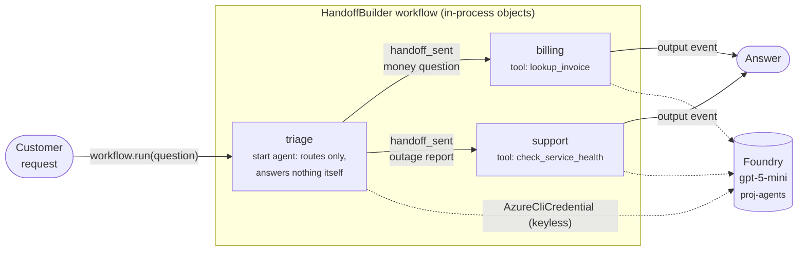
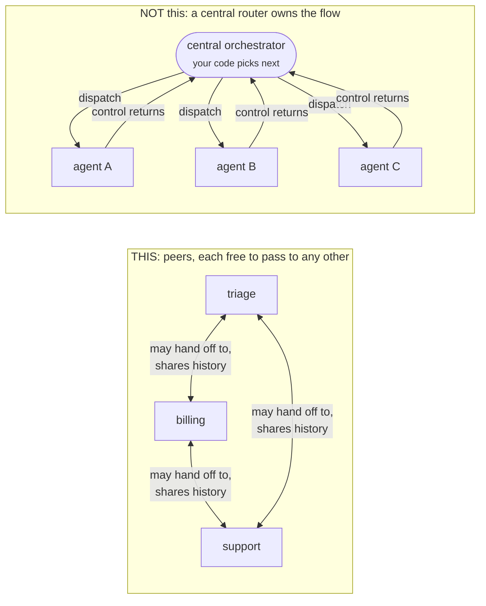
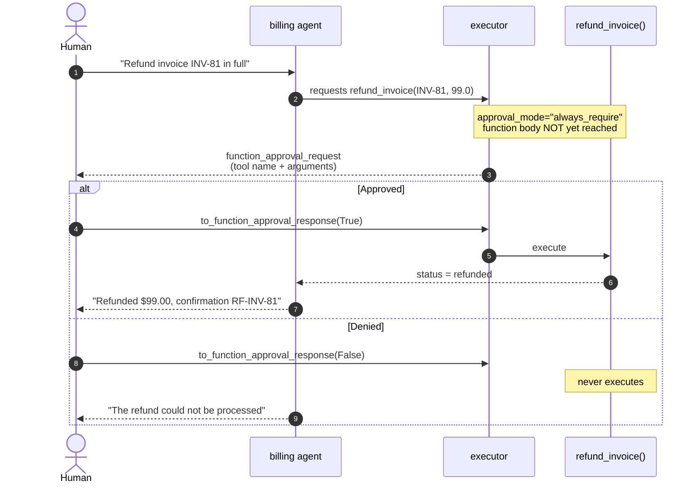
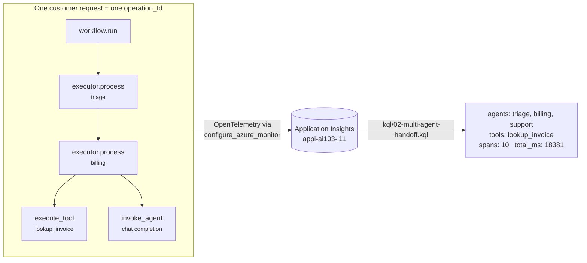

# Build agents by using Foundry

Part of **Objective domain 2: Implement generative AI and agentic solutions** (30-35%), Lesson 11 (L11).

This objective group spans two lessons, L10 and L11. The full objective list is shown verbatim in both modules so neither drops a learning objective.

## Learning objectives covered

Quoted verbatim from the AI-103 objective domain:

1. Define agent roles, goals, conversation-tracking approach, and tool schemas
2. Build agents that integrate retrieval, function-calling, and conversation memory
3. Integrate agent tools, including APIs, knowledge stores, search, content understanding, and custom functions
4. Implement orchestrated multi-agent solutions
5. Build autonomous or semiautonomous workflows with safeguards and approval flow controls
6. Integrate monitoring into deployed agents, evaluate agent behavior, and perform error analysis

**L10 and L11 split that list.** L10 owns objectives 1-3 (tool schemas, function calling, conversation memory, tool integration). **L11 demos objectives 4, 5, and 6:**

| Objective | Demo | The question it answers |
| --- | --- | --- |
| **4** orchestrated multi-agent | `m11_multi_agent.py` | *Which* agent should handle this request? |
| **5** safeguards and approval flow | `m11_approval_flow.py` | Should this action be allowed to happen *at all*? |
| **6** monitoring and error analysis | `kql/` + tracing in both demos | What actually happened, across all the agents? |

## Demos

Run demos directly from this folder. Python demos use **uv**, and authentication is **keyless** through `az login`.

```bash
uv sync                  # build the per-lesson venv
az login                 # keyless auth (AzureCliCredential)
cp .env.example .env     # then fill in your Foundry + App Insights values
```

Need the environment itself? `infra/ai103-lesson-env.bicep` builds the whole thing (Foundry account + project + model + Application Insights) in one command, and its outputs map 1:1 onto the `.env` values above. See `infra/README.md`.

### What is in this folder

| File | What it is |
| --- | --- |
| `m11_multi_agent.py` | Headline demo: orchestrated hand-off, traced (LO4 + LO6) |
| `m11_approval_flow.py` | Human-in-the-loop approval gates (LO5) |
| `generate_traffic.py` | Optional telemetry padding. Needs a portal-provisioned agent (see below) |
| `kql/` | Three ready-to-paste Application Insights queries |
| `Warner.AI-103.Lesson-11-demo-runbook.md` | The SAY/DO/PAUSE recording runbook |
| `orchestration-diagram.md` | Deck-authoring companion. The same diagrams inlined below, **plus** a pick-the-pattern decision chart covering all five built-in orchestrations, with the MS Learn source links |

### Coming from LangGraph or a hand-written tool loop?

These orchestration patterns are not a new theory. They are prebuilt shapes for a loop you would otherwise write yourself, so the vocabulary shifts more than the ideas do:

| You already know | Agent Framework calls it | What actually changed |
| --- | --- | --- |
| A LangGraph `StateGraph` you add nodes and edges to | A **workflow** from `HandoffBuilder`, `SequentialBuilder`, and friends | You pick a prebuilt edge topology instead of drawing edges yourself |
| Conditional edges, where your router function returns the next node name | **Handoff**, where the *model* picks the next agent by calling a hidden handoff tool | The routing decision moved from your Python into a model tool call |
| A `TypedDict` state threaded through nodes | The shared **conversation history**, broadcast to every participant | State is a message list, not a dict you designed |
| A `tool_use` loop you write by hand | The **executor** running that loop for you | You lose the hand-written `while`, and gain a place to hang approval gates |

The one sentence for this whole lesson: **in LangGraph your code decides who runs next, and in Handoff the model decides who runs next by calling a tool you never see.**

### `m11_multi_agent.py` -- the headline demo

An orchestrated **multi-agent hand-off**, traced end to end. It covers objective 4 (orchestrated multi-agent solutions) and objective 6 (monitoring and error analysis) in one run.

```bash
uv run python m11_multi_agent.py
uv run python m11_multi_agent.py --dry-run    # show topology, make no Azure calls
uv run python m11_multi_agent.py --no-trace   # run the hand-off, skip telemetry
```

Three specialists behind one front door, built with `HandoffBuilder`.

Read the diagram as a story: the customer asks once, **triage** decides who owns the question, that one specialist answers, and the run stops. Solid arrows carry the conversation; dashed arrows are model calls:



#### Routing view vs. actual topology

The diagram above is the **routing** view: who ends up answering. It isn't the wiring.

Mechanically, `HandoffBuilder` connects the participants as a **mesh with no central orchestrator**. Each agent decides its own next hop, and participants broadcast their responses so every agent keeps a consistent conversation history. There is no coordinator that control returns to:



If you are looking for the supervisor node, there isn't one. Every agent is handed a set of hidden handoff tools, one per agent it may pass to, and "routing" is just that agent choosing to call one. The mesh shows who is *allowed* to pass to whom, not traffic that flows on every turn.

Two consequences that are genuinely exam-relevant:

- **No central authority.** Adding a fourth specialist means adding one participant, not editing a routing table that grows forever.
- **Handoff tool calls are filtered out** of the history before the next agent sees them, so internal workflow mechanics never confuse the model. Only user and agent messages sync.

This is also the difference from **agent-as-tools**: there, a primary agent delegates a subtask and control *returns* to it, so the primary keeps ownership. In a hand-off the receiving agent takes **full ownership** of the task and the conversation goes with it.

The agents are **in-process objects**, so there is no agent card to publish and nothing to provision in the portal before this runs. Each run prints the routing decision as it happens:

```text
  customer: The Contoso portal is really slow today. Is something wrong?
  expected route: support
    -> HAND-OFF      : triage -> support
    -> answered by   : support
    -> routed to     : support  [as expected]
  answer: Our monitoring shows the Contoso portal is currently degraded...
```

Three scenarios run in order: a billing question, a support question, and a deliberate miss (an invoice ID that doesn't exist) so the error-analysis query has something real to classify.

Two implementation details worth calling out on camera, because both are easy to get wrong:

- Every participant needs `require_per_service_call_history_persistence=True`, or `HandoffBuilder` raises at build time.
- Each scenario builds a **fresh workflow**. A handoff workflow ends its turn waiting for the customer's reply, so reusing one instance carries the previous conversation forward and every scenario answers with the first one's data.

### `m11_approval_flow.py` -- safeguards and approval gates

Human-in-the-loop control, covering objective 5 (safeguards and approval flow controls).

```bash
uv run python m11_approval_flow.py               # scripted: approve, then deny
uv run python m11_approval_flow.py --interactive # you answer y/n at the gate
uv run python m11_approval_flow.py --dry-run     # show the gates, make no Azure calls
```

Where the hand-off demo asks *which agent handles this*, this one asks *should this action
happen at all*. The answer is one parameter on the tool, and the tools are risk-tiered:

| Tool | Mode | Behavior |
| --- | --- | --- |
| `lookup_invoice` | `never_require` | Read-only. Runs unattended. |
| `refund_invoice` | `always_require` | Moves money. Stops for a human. |

The framework halts **before** the function body executes and returns a
`function_approval_request` instead of a result. Your code answers with
`request.to_function_approval_response(approved)` and the run resumes from the pause.

If you have hand-written a `tool_use` loop, this is exactly the moment where you would have
dropped an `input()` before dispatching the tool. Here it is a declared parameter instead of
loop logic you maintain:



That placement is the whole point: a safeguard in the system prompt is a suggestion the model can
reason its way around, while a gate on the executor is a control it can't reach past.

Three scenarios run in order, and the first two are the contrast worth pausing on. The same
request, from the same agent, on the same model produces `status: refunded` when approved and
leaves `status: paid` when denied. The third is read-only, so no gate fires at all.

Two implementation details that will bite you:

- **Use an `AgentSession`.** Reasoning models (the gpt-5 family) emit a `reasoning` item paired
  with each `function_call`, and the service rejects a turn that replays the call without its
  partner (`400 ... provided without its required 'reasoning' item`). The docs' sessionless
  pattern of hand-rebuilding the message list fails here; the session keeps the pair intact.
- **Print the arguments at the gate, not just the tool name.** "Approve `refund_invoice`?" is
  not informed consent; "Approve `refund_invoice(invoice_id='INV-81', amount_usd=99.0)`?" is.

The demo refunds **INV-81**, which is seeded as `paid` on purpose. Pointed at the unpaid INV-77,
the model correctly refuses to call the refund tool at all and the gate never fires.

### Observability

The demo wires OpenTelemetry to Application Insights with `configure_azure_monitor`, so one run emits `invoke_agent`, `execute_tool`, and `executor.process` spans.

In plain terms: a **span** is one timestamped row saying "this thing ran, and it took this long." One customer request scatters a pile of those rows across three agents, and they all carry the same **`operation_Id`**, a correlation ID stamped on everything in a single request. Group by that ID and you have reassembled the whole request from its pieces. The span names are the vocabulary the queries filter on:

| Span name | Emitted when |
| --- | --- |
| `workflow.run` | The whole request starts |
| `executor.process` | One agent takes its turn |
| `invoke_agent` | An agent calls the model |
| `execute_tool` | A tool function actually runs |

That shared `operation_Id` is what lets the multi-agent query follow a request across three agents:



Those result values are from a real verified run, not an illustration.

Set `APPLICATIONINSIGHTS_CONNECTION_STRING` in `.env` to turn tracing on. Leave it unset and the hand-off still runs, reporting that tracing is off.

If `02-multi-agent-handoff.kql` returns **nothing**, that isn't an empty result, it's a diagnosis: distributed tracing isn't wired up correctly. When it returns rows, your multi-agent telemetry is genuinely correct.

Ready-to-paste queries are in `kql/`:

| Query | Answers |
| --- | --- |
| `01-agent-kpis.kql` | Which agent is slow, which is failing, how often each runs |
| `02-multi-agent-handoff.kql` | Follow one customer request across all three agents |
| `03-error-taxonomy.kql` | What is going wrong, grouped by kind |

Allow 1-3 minutes for ingestion after a run, then paste a query into **Application Insights -> Logs**.

### `generate_traffic.py` -- optional, needs extra setup

Adds telemetry volume against a **portal-provisioned prompt agent**, so the KPI and error queries have more than one agent shape to report on.

```bash
uv run python generate_traffic.py --rounds 3
```

> **Not part of the recorded demo, and it won't run out of the box.** Unlike the two demos above, this one does **not** create its agent in code. It calls an agent that must already exist in the Foundry portal, referenced by `TRAFFIC_AGENT` in `.env` (default `l10-support-agent`). Against a freshly rebuilt environment that agent isn't there, and every round fails with `404 ... Agent <name> ... not found`. Create a prompt agent of that name in the portal first, or skip this script -- the KQL queries all work off `m11_multi_agent.py` alone.

---
Part of the [AI-103 course repository](https://github.com/timothywarner-org/ai103) by Tim Warner.
