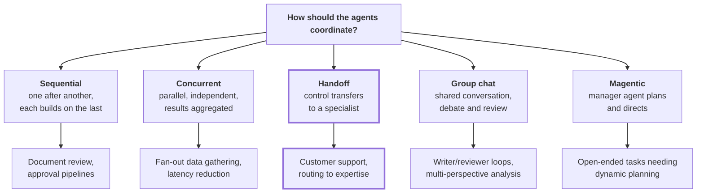
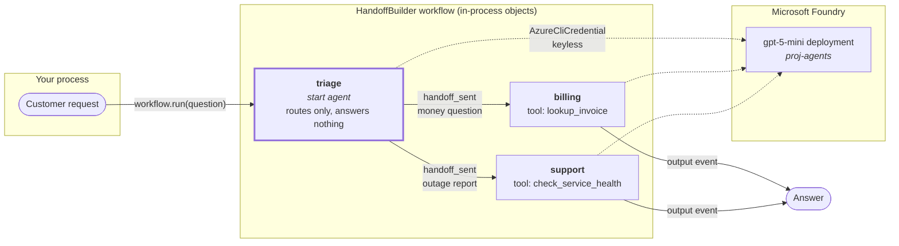
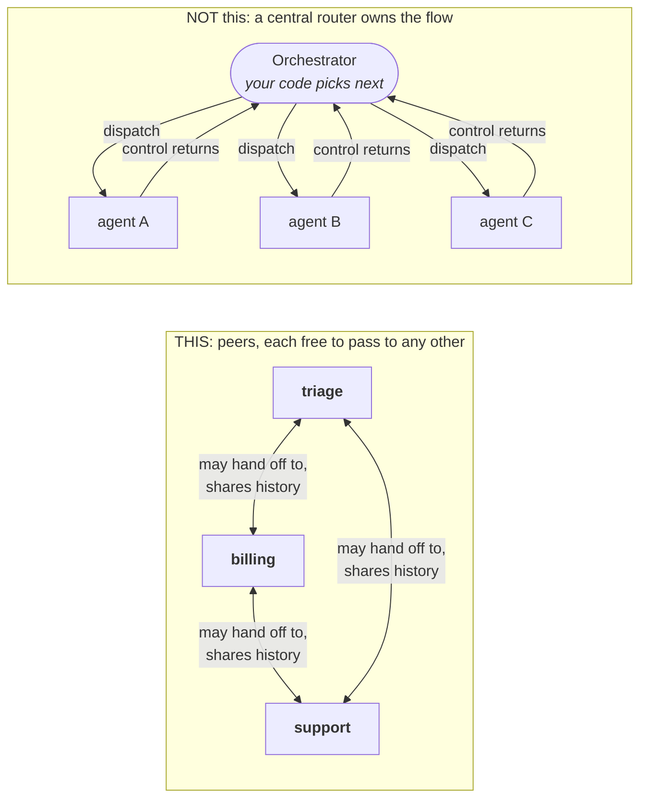
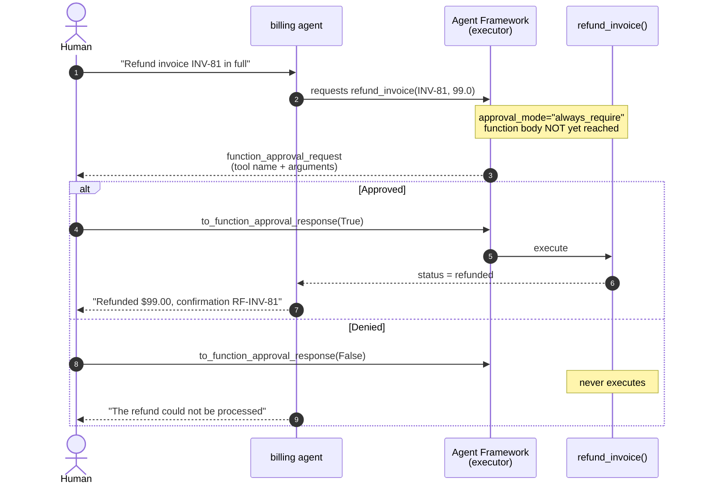
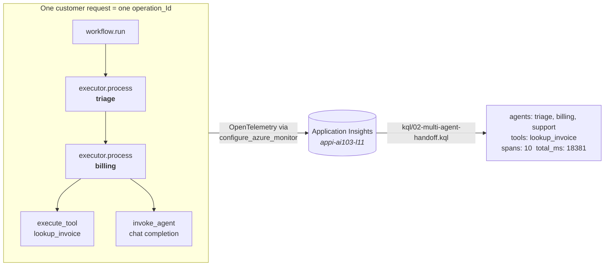

# Lesson 11 -- Multi-agent orchestration (AI-103 LO4 / LO5 / LO6)

Diagrams for the L11 deck and runbook, grounded in the Microsoft Agent Framework
[workflow orchestrations](https://learn.microsoft.com/agent-framework/workflows/orchestrations/) docs
and the [AI-103 skills measured](https://learn.microsoft.com/credentials/certifications/resources/study-guides/ai-103)
list (April 16, 2026).

---

## 0. Read this first if you have used LangGraph or the Anthropic API

The five patterns below are **not** a new theory of orchestration. They are five prebuilt
shapes for a loop you would otherwise write yourself. The plain-English mapping:

| You already know | Agent Framework calls it | What actually changed |
| --- | --- | --- |
| A LangGraph `StateGraph` where you add nodes and edges | A **workflow** built by `HandoffBuilder`, `SequentialBuilder`, etc. | You pick a prebuilt edge topology instead of drawing edges yourself |
| LangGraph conditional edges, where your router function returns the next node name | **Handoff**, where the *model* picks the next agent by calling a hidden handoff tool | The routing decision moved from your Python into a model tool call |
| A LangGraph `TypedDict` state you thread through nodes | The shared **conversation history**, broadcast to every participant | State is a message list, not a dict you designed |
| An Anthropic `tool_use` loop you write by hand | The **executor** running the loop for you | You lose the hand-written `while` loop and gain a place to hang approval gates |

One sentence for the whole lesson: **in LangGraph your code decides who runs next, and in
Handoff the model decides who runs next by calling a tool you never see.**

---

## 1. The five built-in patterns (pick-the-pattern slide)

Exam-relevant framing: AI-103 LO4 says "implement orchestrated multi-agent solutions." The
exam expects you to **choose** the right pattern, so this is the decision slide.

Read each branch as: **coordination style, then the job it fits.**

**L11 demos the Handoff pattern** (the one with the heavier border). It is the clearest
teaching case because the routing decision is visible on every single turn.

---

## 2. What L11 actually builds

Three specialists behind one front door, in `m11_multi_agent.py`.

Read it as a story: the customer asks once, **triage** decides who owns the question,
that one specialist answers, and the run stops. Solid arrows are the conversation moving.
Dashed arrows are ordinary model calls to Foundry.

**Say this out loud:** the specialists never talk to the customer directly and never hand off
again. They answer and stop.

---

## 3. The correction worth making on camera

The picture above is the **logical routing view**: who ends up answering. It is not the wiring.

The docs are explicit that handoff is implemented as a **mesh with no central orchestrator**,
and that every participant broadcasts its response so all agents keep a consistent conversation
history.

**Why this trips up LangGraph people.** In LangGraph you can point at the supervisor node and
say "that is the router." Here there is no such node. Every agent is handed a set of hidden
handoff tools, one per agent it is allowed to pass to, and "routing" is just that agent choosing
to call one. The mesh in the right-hand box is who is *allowed* to pass to whom, not traffic
that actually flows on every turn.

Two consequences that are genuinely exam-relevant:

1. **There is no central authority.** Each agent decides its own next hop, which is why adding a
   fourth specialist means adding one participant rather than editing a routing table.
2. **Handoff tool calls are filtered out** of the history before the next agent sees them, so the
   internal workflow mechanics never confuse the model. Only user and agent messages sync.

Contrast with **agent-as-tools**, where a primary agent delegates a subtask and control *returns*
to it. In handoff, the receiving agent takes **full ownership** of the task.

---

## 4. LO5 -- where the approval gate sits

This is `m11_approval_flow.py`. The gate is on the executor, not in the prompt.

**In one line:** the model asks to run a tool, the framework pauses *before* the function body
runs, a human says yes or no, and only then does the code execute. If you have written an
Anthropic `tool_use` loop, this is the moment where you would have inserted your own `input()`
before dispatching the tool. Agent Framework gives you that pause as a declared parameter
instead of hand-rolled loop logic.

**The teaching line:** a safeguard written in the system prompt is a suggestion the model can
reason its way around. A gate declared on the tool is a control it cannot reach past. Same
request, same agent, same model -- the only variable is the human.

Risk-tier the tools rather than gating everything:

| Tool | `approval_mode` | Behavior |
| --- | --- | --- |
| `lookup_invoice` | `never_require` | Read-only, runs unattended |
| `refund_invoice` | `always_require` | Moves money, stops for a human |

---

## 5. LO6 -- why one operation_Id makes this observable

**The plain version.** Every unit of work the framework does emits one **span**, which is just a
timestamped row saying "this thing ran, and it took this long." One customer request produces a
pile of those rows across three agents. They all carry the same **`operation_Id`**, a shared
correlation ID stamped on everything in one request. Group the rows by that ID and you have
reassembled the whole request from the pieces.

The span names are the vocabulary you query on:

| Span name | Emitted when |
| --- | --- |
| `workflow.run` | The whole request starts |
| `executor.process` | One agent takes its turn |
| `invoke_agent` | An agent calls the model |
| `execute_tool` | A tool function actually runs |

Every agent in a single hand-off shares **one `operation_Id`**. That is exactly what lets the KQL
query follow a request across three agents instead of correlating three disconnected logs by
timestamp.

If `02-multi-agent-handoff.kql` returns **nothing**, that is not an empty result, it is a
diagnosis: distributed tracing is not wired up correctly. When it returns rows, your multi-agent
telemetry is genuinely correct.

---

## Sources

- [Workflow orchestrations](https://learn.microsoft.com/agent-framework/workflows/orchestrations/) -- the five patterns
- [Handoff orchestration](https://learn.microsoft.com/agent-framework/workflows/orchestrations/handoff) -- mesh topology, context sync, tool approval, `HandoffAgentExecutor`
- [Human-in-the-loop](https://learn.microsoft.com/agent-framework/workflows/human-in-the-loop) -- approval request/response model
- [AI-103 study guide](https://learn.microsoft.com/credentials/certifications/resources/study-guides/ai-103) -- skills measured as of April 16, 2026
