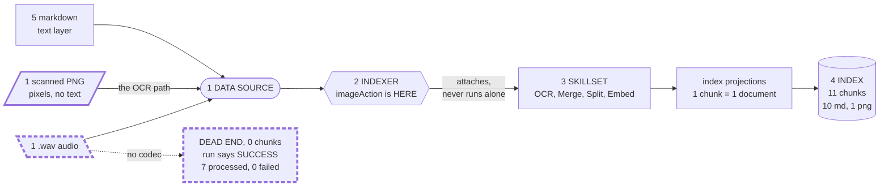
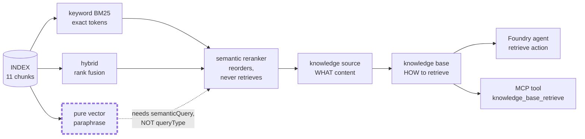
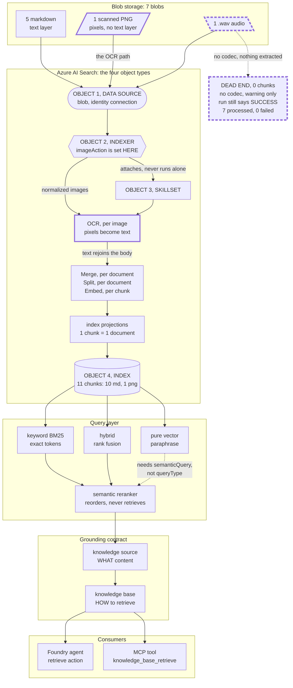

# L17 retrieval topology

One dependency chain, seven blobs in, one callable tool out. Two paths carry the
lesson: the **scanned PNG**, which proves six stages in a single query result,
and the **.wav**, which proves a green run can index nothing at all.

## Which diagram to put on screen

The full chain is **13 ranks deep**. It renders about 0.44:1 tall or 8.35:1 wide,
so it does not fit a 16:9 frame at readable size either way. Use the two beat
diagrams on camera and keep the full chain as the reference.

| On camera | Use |
| --- | --- |
| Beat 2, ingestion | **Diagram A** below. Fits the frame. |
| Beat 3, retrieval | **Diagram B** below. Fits the frame. |
| README, GitHub, reference | **Diagram C**, the full chain. Scroll it. |

---

## Diagram A -- Beat 2: seven blobs in, eleven chunks out

**Point at:** the four numbered objects, then the dashed dead end. The `.wav` is
counted as **processed** and contributes **zero**. A warning, not a failure.

---

## Diagram B -- Beat 3: one index, four query modes, one callable tool

**Point at:** the dashed vector edge. That is the **silent no-op** -- HTTP 200,
results returned, reranker never invoked. Raising `k` would not have fixed it.

---

## Diagram C -- the full chain, for reference

Read it top to bottom. The four numbered objects are Beat 1, the chain down to
the index is Beat 2, and everything below the index is Beat 3.

## What to point at on camera

- **The four numbered objects.** Data source, indexer, skillset, index. Every ingestion question is "which of these four is wrong?"
- **`imageAction` is on the INDEXER.** The arrow from indexer to OCR is the dependency. No normalized images, no OCR, and the run still says success.
- **Trace the PNG.** OCR, Merge, Split, Embed, projection, index. Six stages, one citable chunk out of the 11.
- **The dashed dead end.** The .wav is counted as processed and contributes zero. A warning, not a failure.
- **Reranker sits after retrieval, not instead of it.** It reorders what BM25 and hybrid already found. It cannot rescue a miss.
